## Part 1. Инструмент ipcalc  

### 1.1. Сети и маски  
1) Для определения адреса сети 192.167.38.54/13 использую команду:  
ipcalc 192.160.0.0/13  
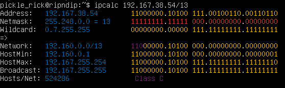  
Рис. 1 — Сети и маски  
Адрес сети: 192.160.0.0/13  

2) Для перевода маски 255.255.255.0 в префиксную и двоичную запись использую команду:  
ipcalc 0.0.0.0 255.255.255.0  
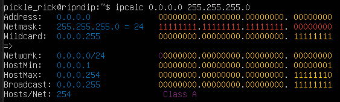  
Рис. 2 — Перевод формата записи маски  
Префиксная форма: /24  
Двоичная запись: 11111111.11111111.11111111.00000000  
Для перевода /15 в обычную и двоичную использую:  
ipcalc 0.0.0.0/15  
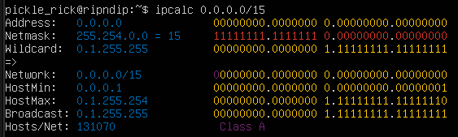  
Рис. 3 — Перевод формата записи маски  
Обычная форма: 255.254.0.0  
Двоичная запись: 11111111.11111110.00000000.00000000  
Для перевода 11111111.11111111.11111111.11110000 в обычную и префиксную запись, считаю количество единиц, так как двоичную форму адреса передать на вход ipcalc нельзя:  
ipcalc 0.0.0.0/28  
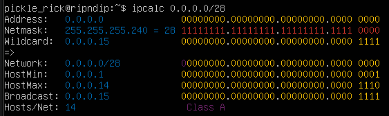  
Рис. 4 — Перевод формата записи маски  
Обычная запись маски: 255.255.255.240  
Префексная запись: /28  

3) Для выявления минимального и максимального хостов в сети 12.167.38.4 при масках: /8, 11111111.11111111.00000000.00000000, 255.255.254.0 и /4 использую 4 команды:  
ipcalc 12.167.38.4/8  
ipcalc 12.167.38.4/16  
ipcalc 12.167.38.4 255.255.254.0  
ipcalc 12.167.38.4/4  
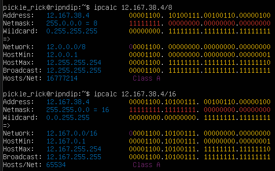  
Рис. 5 — Минимальные и максимальные хосты в сети /8 и /16  
Минимальный хост: 12.0.0.1 и 12.167.0.1  
Максимальный хост: 12.255.255.254 и 12.167.255.254  
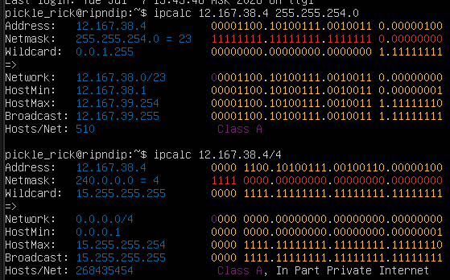  
Рис. 6 — Минимальные и максимальные хосты в сети 255.255.254.0 и /4 
Минимальный хост: 12.167.38.1 и 0.0.0.1  
Максимальный хост: 12.167.39.254 и 15.255.255.254  

### 1.2. localhost  
Весь диапазон адресов 127.0.0.0/8 (от 127.0.0.0 до 127.255.255.255) зарезервирован для loopback-целей. Это означает, что любой пакет, отправленный на любой адрес из этого диапазона, будет "замкнут" обратно на ту же машину, поэтому для ip 127.0.0.2, 127.1.0.1 обращение возможно, а для 194.34.23.100, 128.0.0.1 - нет.  

### 1.3. Диапазоны и сегменты сетей  
1) Из перечисленных IP можно использовать в качестве публичного: 134.43.0.2, 192.169.168.1, 172.68.0.2, 192.172.0.1, 172.0.2.1, а только в качестве частных: 10.0.0.45, 192.168.4.2, 172.20.250.4, 172.16.255.255, 10.10.10.10.  
Класс	Диапазон	                   Маска подсети  
A	    10.0.0.0 – 10.255.255.255	   /8 (255.0.0.0)  
B	    172.16.0.0 – 172.31.255.255	   /12 (255.240.0.0)  
C	    192.168.0.0 – 192.168.255.255  /16 (255.255.0.0)  

2) Для того, чтобы установить диапозон ip адресов, нужно включить биты из Wildcard в Network  
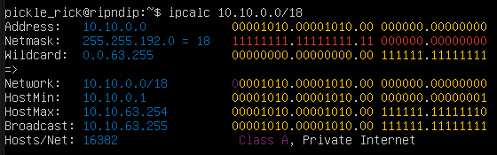  
Рис.7 - Вывод комманды ipcalc 10.10.0.0/18  
Результат: 10.10.0.0 — сетевой, 10.10.63.255 - широковещательный  
Из перечисленных IP-адресов шлюза у сети 10.10.0.0/18 возможны: 10.10.0.2, 10.10.10.10, 10.10.1.255  

##  Part 2. Статическая маршрутизация между двумя машинами  
Команда ip a показывает существующие сетевые интерфейсы:  
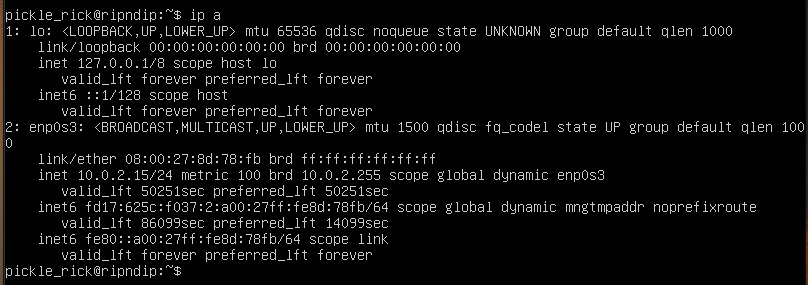  
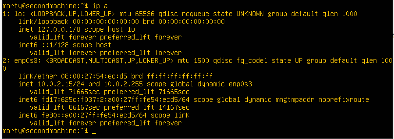  
Рис.8 - Скрин с вызовом и выводом использованной команды на машинах 1 и 2  
lo - локальная петля  
enp0s3 - проводной сетевой интерфейс  
UP - состояние (включено)  
link/ether - MAC-адрес: 08:00:27:8d:78:fb  
inet - IPv4-адрес: 10.0.2.15/24  
inet6 - IPv6-адрес  

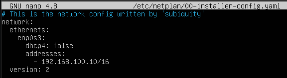  
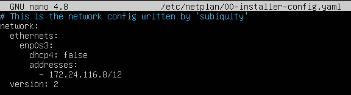  
Рис.9 - Скрин с содержанием изменённого файла etc/netplan/00-installer-config.yaml для каждой машины  
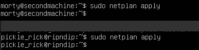  
Рис.10 - Скрин с вызовом и выводом команды netplan apply  

### 2.1. Добавление статического маршрута вручную  
Прежде нужно убедиться, что машины физически (виртуально) подключены к одному коммутатору.В настройках VirtualBox обеих машин выбераю тип подключения «Внутренняя сеть» (Internal Network) и указываю одинаковое имя intnet.  
Имена сетевых интерфейсов беру из предыдущей части - enp0s3  
С помощью команды ipcalc выясняем адреса сетей. И добавляем статический маршрут от одной машины до другой и обратно при помощи команд:  
ip r add ... dev enp0s3  
Проверяем соединение пингом  
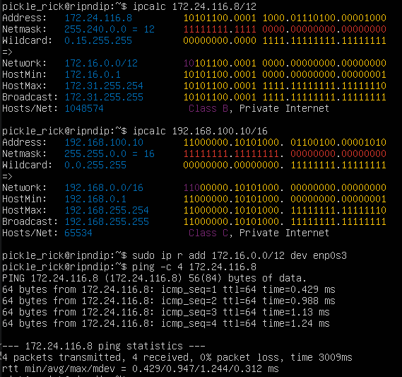  
Рис.11 - ipcalc, ip r add и ping на первой машине  
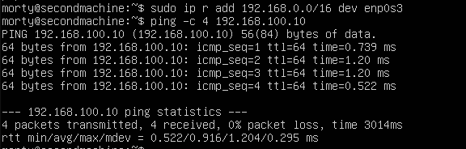  
Рис.12 - ip r add и ping на второй машине  

### 2.2. Добавление статического маршрута с сохранением  
После перезапуска машин, добавляю статический маршрут от одной машины до другой с помощью файла /etc/netplan/00-installer-config.yaml.  
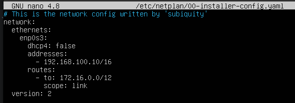  
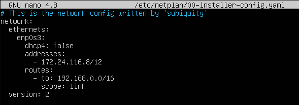  
Рис.13 - Скрины с содержанием изменённого файла /etc/netplan/00-installer-config.yaml.  

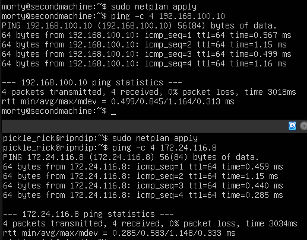  
Рис.14 - Пропингованные соединения между машинами  

## Part 3. Утилита iperf3  
### 3.1. Скорость соединения  
8 Mbps - 1 MB/s  
100 MB/s - 800 000 Kbps  
1 Gbps - 1000 Mbps  
### Утилита iperf3  
Для установки утилиты iperf3, нужно восстановить подключение к интернету, в настройках виртуальной машины (в VirtualBox/VMware) добавить второй сетевой адаптер и включить его в режим NAT, перезапустить машину, с помощью команды ip a выяснить название нового адаптера и прописать его в /etc/netplan/00-installer-config.yaml:  
    enp0s8:  
      dhcp4: true  
Чтобы протестировать пропускную способность сети, нужно запустить iperf3 в режиме сервера с помощью флага -s. По умолчанию он будет прослушивать порт 5201:  
iperf3 -s -f K  
На локальной машине запустим iperf3 в режиме клиента с помощью флага -c и укажем хост, на котором работает сервер (используем либо его IP-адрес, либо домен, либо имя хоста):  
iperf3 -c 192.168.10.1 -f K  
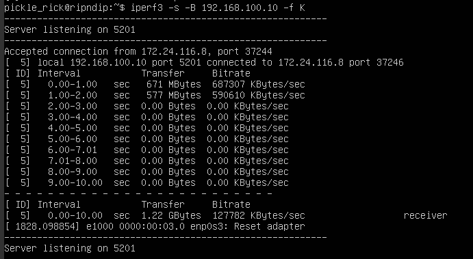  
Рис.15 - Результат iperf3 на первой машине  
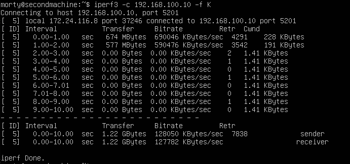  
Рис.16 - Результат iperf3 на второй машине  

## Part 4. Сетевой экран  
### 4.1. Утилита iptables  
Создание файла /etc/firewall.sh, имитирующего файрвол, на ws1 и ws2:  
  
Рис.17 - /etc/firewall.sh на ws1  
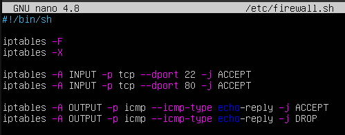  
Рис.18 - /etc/firewall.sh на ws2  
Запуск файлов и проверка разрешений:  
sudo iptables -L -n -v  
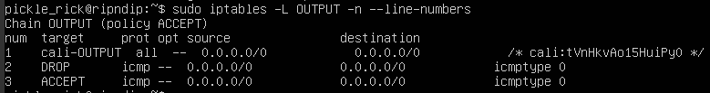  
Рис.19 - sudo iptables -L -n -v  на ws1  
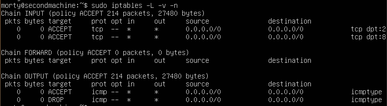  
Рис.20 - sudo iptables -L -n -v  на ws2  
Теперь нужно пропинговать серверы для проверки работы правил  
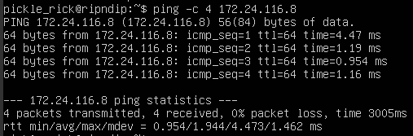  
Рис.21 - Результаты пинга ws2 с ws1  
Когда ws2 отправляет ответ, её пакет в цепочке OUTPUT натыкается первым делом на разрешающее правило (ACCEPT). Пакет улетает к ws1, а идущий следом запрет уже не обрабатывается  
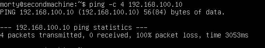  
Рис.22 - Результаты пинга ws1 с ws2  
Запрос доходит до ws1, но когда ws1 пытается отправить ответ обратно, пакет попадает в её цепочку OUTPUT. Там первым стоит запрещающее правило (DROP), пакет уничтожается, а до разрешающего правила дело не доходит  

### 4.2. Утилита nmap  
ip машины, которая не пингуется - 192.168.100.10 (первая машина), со второй машины проверяю командой:  
ping -c 4 192.168.100.10  
после чего утилитой nmap демонстрирую, что хост машины запущен:  
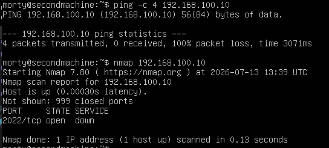  
Рис.23 - Результаты пинга ws1 с ws2 и вывод команды nmap  

## Part 5. Статическая маршрутизация сети  
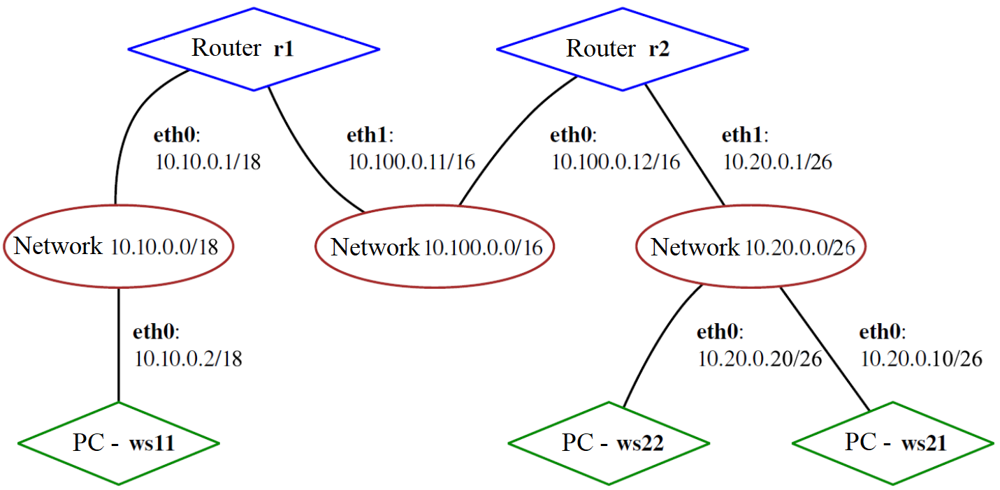  
Рис.24 - Схема статической маршрутизации сети  
Для начала в настройках VB нужно добавить сетевые адаптеры: 1 адаптер по умолчанию интернет, 2 адапер для внутренний сети, 3 адаптер только для связи роутеров  

### 5.1. Настройка адресов машин  
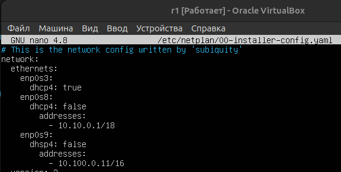  
Рис.29 - Настройка конфигурации роутера r1  
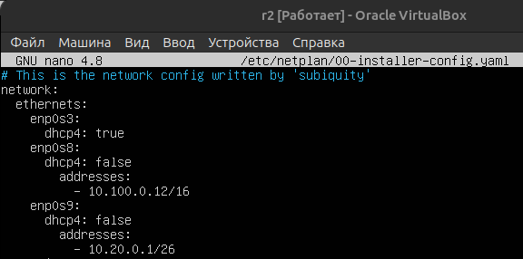  
Рис.30 - Настройка конфигурации роутера r2  
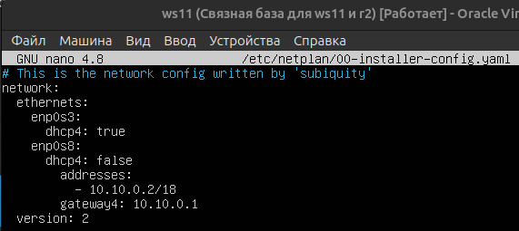  
Рис.31 - Настройка конфигурации машины ws11  
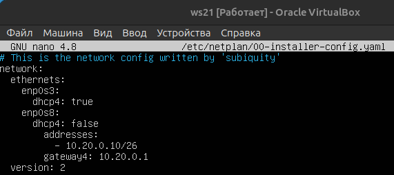  
Рис.32 - Настройка конфигурации машины ws21  
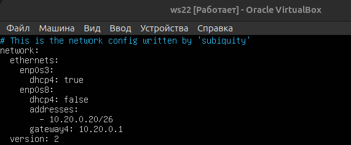  
Рис.33 - Настройка конфигурации машины ws22  
Перезапускаю сервис сети командой:  
sudo systemctl restart systemd-networkd  
и командой:  
ip -4 a  
проверяю, что адрес машины задан верно  
Проверяю доступность роутера r1 и машины ws22 командой ping:  
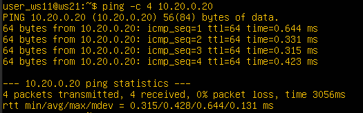  
Рис. 34 - Проверка доступности r1  
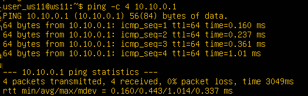  
Рис. 35 - Проверка доступности ws22  

### 5.2. Включение переадресации IP-адресов  
Для включения переадресации IP выполняю команду на роутерах:  
sysctl -w net.ipv4.ip_forward=1  
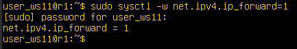  
Рис. 36 - Включение переадресации IP на роутере r1  
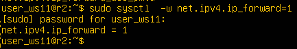  
Рис. 37 - Включение переадресации IP на роутере r2  
Включаю IP-переадресацию на постоянной основе через файл /etc/sysctl.conf  
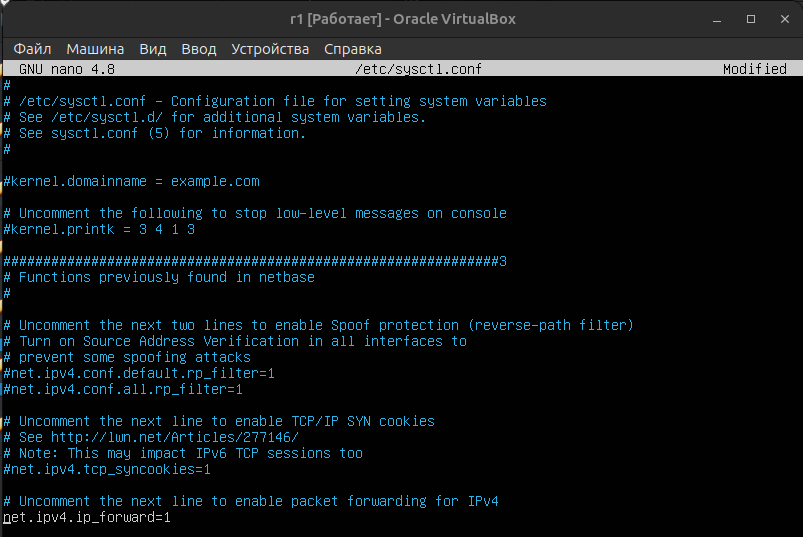  
Рис. 38 - Включение переадресации IP на роутере r1  
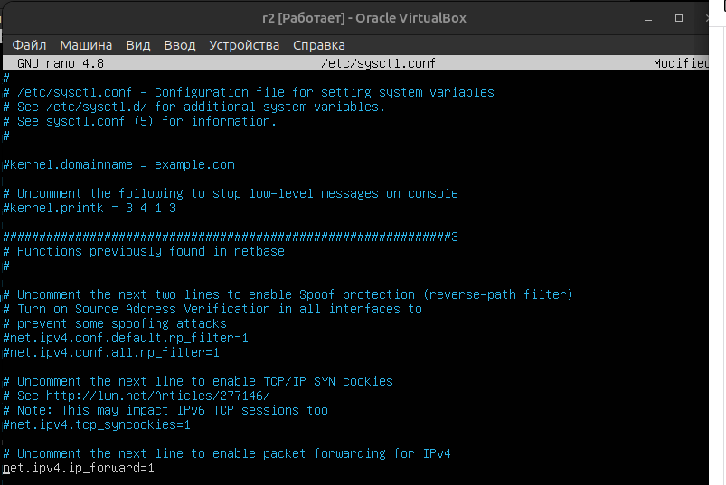  
Рис. 39 - Включение переадресации IP на роутере r2  

### 5.3. Установка маршрута по умолчанию  
Для установки маршрута по умолчанию редактирую файл /etc/netplan/00-installer-config.yaml  
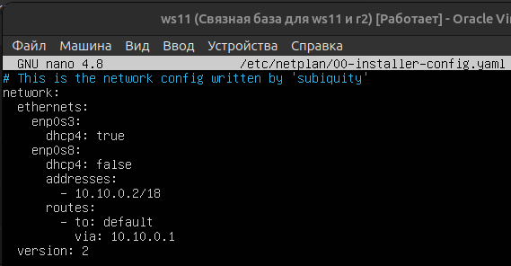  
Рис. 40 - Установка маршрута по умолчанию на ws11  
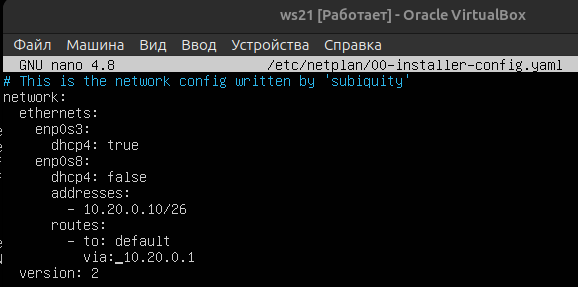  
Рис. 41 - Установка маршрута по умолчанию на ws21  
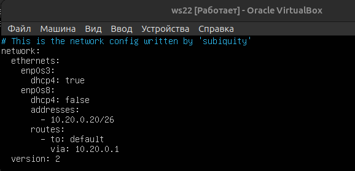  
Рис. 42 - Установка маршрута по умолчанию на ws22  
Проверяю настройки маршрута по умолчанию при помощи команды  
ip r  
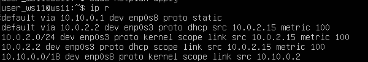  
Рис. 43 - Маршрут в таблице маршрутизации  
Пингуею с машины ws11 роутер r2:  
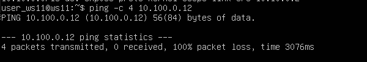  
Рис. 44 - результат пинга с машины ws11 роутера r2  

Для прослушивания трафика на роутере r2 использую команду:  
sudo tcpdump -tn -i enp0s8  
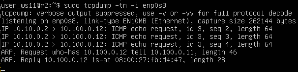  
Рис. 45 - Трафик на роутере r2  
Пинг проходит но роутер ещё не знает о сети машины ws11  

### 5.4. Добавление статических маршрутов  
Добавление статических маршрутов в роутеры для r1 по enp0s9 для r2 по enp0s8:  
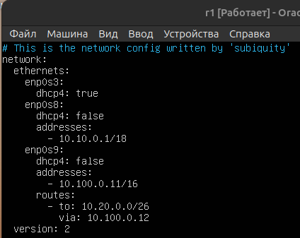  
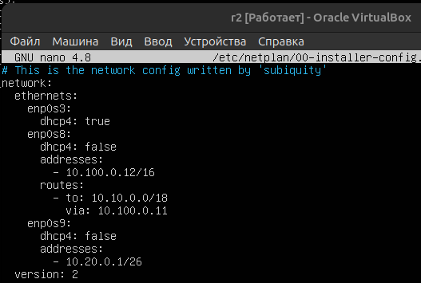  
Рис. 46 - Добавление статических маршрутов в роутеры

Вызываю ip r с таблицами маршрутов на обоих роутерах:  
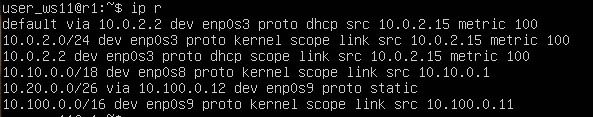  
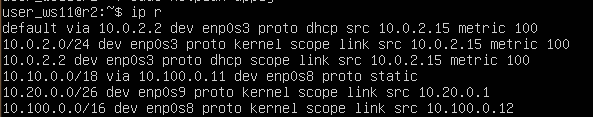  
Рис. 47 - Таблицы маршрутов на обоих роутерах  

Запускаю команды на ws11:  
ip r list 10.10.0.0/[маска сети] и ip r list 0.0.0.0/0  
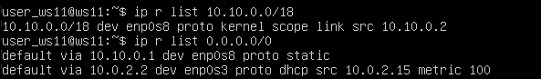  
Рис. 48 - Проверка таблицы маршрутизации ws11  

При поиске пути для отправки пакета ядро Linux проверяет всю таблицу маршрутизации и всегда выбирает тот маршрут, у которого маска сети (префикс) длиннее и точнее, независимо от настроек шлюза по умолчанию (default или 0.0.0.0/0). Пакеты, адресованные в сеть 10.10.0.0/18, отправляются напрямую в интерфейс enp0s8 (scope link), минуя дефолтный шлюз. Маршрут по умолчанию 0.0.0.0/0 используется системой только тогда, когда в таблице вообще нет точных совпадений для целевого IP-адреса.  

### 5.5. Построение списка маршрутизаторов  

Запускаем на r1 команду дампа (меняем на название нашего сетевого интерфейса):  
tcpdump -tnv -i enp0s8  

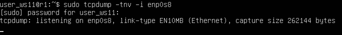  
Рис. 49 - Запуск команды дампа  

На ws11 выполняем traceroute:  
traceroute 10.20.0.10  

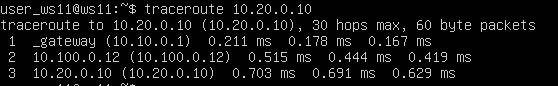  
Рис. 50 - Вывод списка маршрутов от ws11 до ws21  

Просматриваем трафик на r1:  
  
Рис. 51 - Трафик на r1  

По логу дампа видно, как утилита последовательно увеличивает время жизни пакетов (поле TTL - Time to Live). Каждый роутер на пути уменьшает TTL на 1. Когда TTL падает до 0, роутер отбрасывает пакет и возвращает отправителю сообщение ICMP Time Exceeded. Когда пакет с достаточным запасом TTL долетает до целевого хоста 10.20.0.10, тот фиксирует запрос к закрытому UDP-порту и возвращает ошибку ICMP udp port unreachable (что наглядно зафиксировано в конце лога). Получив этот ответ, traceroute завершает построение маршрута  

### 5.6. Использование протокола ICMP при маршрутизации  
Запускаем на r1 перехват сетевого трафика, проходящего через enp0s8 с помощью команды:  
tcpdump -n -i enp0s8 icmp  

  
Рис. 52 - Запуск команды дампа  

Пропингуем с ws11 несуществующий IP (например, 10.30.0.111) с помощью команды:
ping -c 1 10.30.0.111  
  
Рис. 53 - Результат пинга  
  
Рис. 54 - Трафик на r1  

## Part 6. Динамическая настройка IP с помощью DHCP  

Устанавливаем dhcp на r2:  
sudo apt install isc-dhcp-server  
Настраиваем в файле /etc/dhcp/dhcpd.conf конфигурацию службы DHCP: 
sudo nano /etc/dhcp/dhcpd.conf  
  
Рис. 55 - Редактирование файла dhcpd.conf  

В файле resolv.conf прописываю nameserver 8.8.8.8  
  
Рис. 56 - Добавление nameserver  
перезагружаем службу dhcpd:  
sudo systemctl restart isc-dhcp-server!  
[alt text](img/2.65.png)  
Рис. 57 - Перезагрузка службы dhcpd  
Машину ws21 перезагружаю при помощи reboot и через ip a адрес не определяется, поэтому принудительно добавляю его через команду:  
sudo dhclient enp0s8  
И она получила адрес  
  
Рис. 58 - Проверка ip адреса  
Вверху можно увидеть, что после перезагрузки машины ip адрес не был получен автоматически, поэтому назначаем обновляем принудительно, затем при повторном вызове ip a можно увидеть динамический ip адрес.  
Пингуем ws22 с ws21:  
ping 10.20.0.20  
  
Рис. 59 - Результат пинга  

Указываю MAC-адрес у ws11, для этого в etc/netplan/00-installer-config.yaml добавляю строки: macaddress: 10:10:10:10:10:BA, dhcp4: true.  

  
Рис. 60 - etc/netplan/00-installer-config.yaml  

Для r1 настраиваю аналогично r2, но выдача адресов с жесткой привязкой к MAC-адресу (ws11).  
  
Рис. 61 - Редактирование файла dhcpd.conf  
  
Рис. 62 - Добавление nameserver  

Перезагружаем службу dhcpd:  
sudo systemctl restart isc-dhcp-server  
  
Рис. 63 - Перезагрузка службы dhcpd  
Машину ws21 перезагружаем при помощи reboot
Проверяем ip на ws11:  
ip a  
  
Рис. 64 - Проверка ip адреса  

  
Рис. 59 - Результат пинга ws21  
Запрашиваем ip адрес на ws11:  
sudo dhclient -v  
  
Рис. 65 - Запрос ip адреса  
  
Рис. 66 - Проверка нового ip адреса.  
Параметры декларации подсети (subnet и netmask). Определяют границы левой сети (10.10.0.0) и её маску (255.255.192.0)  
Опция маршрутизатора по умолчанию (option routers). Передаёт клиенту ws11 IP-адрес его основного шлюза (дефолтного маршрутизатора) в этой сети — 10.10.0.1.  
Опция сервера имён (option domain-name-servers). Указывает клиенту IP-адрес DNS-сервера (в данном случае также 10.10.0.1) для последующего разрешения доменных имён в IP-адреса.  
Диапазон динамических адресов (range). Задаёт пул свободных IP-адресов (от 10.10.0.2 до 10.10.0.50), которые сервер может автоматически выдавать любым неизвестным устройствам в сети.  
Директива привязки аппаратного адреса (hardware ethernet). Используется внутри блока host ws11 и указывает серверу уникальный физический MAC-адрес сетевой карты клиента (10:10:10:10:10:BA), по которому сервер будет однозначно идентифицировать данную рабочую станцию.  
Опция фиксированного адреса (fixed-address). Инструктирует DHCP-сервер всегда выдавать клиенту ws11 строго зарезервированный за ним статический IP-адрес — 10.10.0.2, полностью исключая выдачу случайных адресов из общего пула range.  

## Part 7. NAT  

В данной части нам надо установить apach2 на ws22 и r1:  
sudo apt install apache2  
Редактируем файл конфигурации /etc/apache2/ports.conf на ws22 и r1:  
sudo nano /etc/apache2/ports.conf  
  
Рис. 67 - Файл ports.conf  

Запускаем сервер apache2 на ws22 и r1:  
sudo service apache2 start  
  
Рис. 68 - Запуск сервера apache2  
Создаем фаервол на r2:  
  
Рис. 69 - Создание фаервола  
Запускаем фаервол на r2:  
  
Рис. 70 - Запуск фаервола  
Пингуем ws22 с r1:  
  
Рис. 71 - Результат пинга ws22  
Фаервол работает, пинг не проходит  
Теперь добавляем правило разрешающее маршрутизацию всех пакетов ICMP в фаервол:  
  
Рис. 72 - Содержимое файла /etc/firewall.sh  
Запускаем фаервол  
  
Рис. 73 - Запуск фаервола
и пингуем ws22 с r1:  
  
Рис. 74 - Результат пинга ws22  
Добавляем правила snat и dnat:  
  
Рис. 74 - правила snat и dnat  
Запускаем фаервол и проверяем SNAT (Выход наружу). Нам нужно проверить, может ли ws22 подключиться к веб-серверу apache, который запущен на дальнем роутере r1 (его IP-адрес в центральной сети — 10.100.0.11), выполняем команду:  
telnet 10.100.0.11 80  
  
Рис. 75 - Проверка snat  
Проверка DNAT (Вход извне). r1 должен постучаться на внешний адрес роутера r2 (10.100.0.12) на порт 8080, r2 перехватит этот пакет, перепишет адрес и перенаправит его на веб-сервер машины ws22, запускаем на r1:  
telnet 10.100.0.12 8080  
  
Рис. 75 - Проверка dnat  